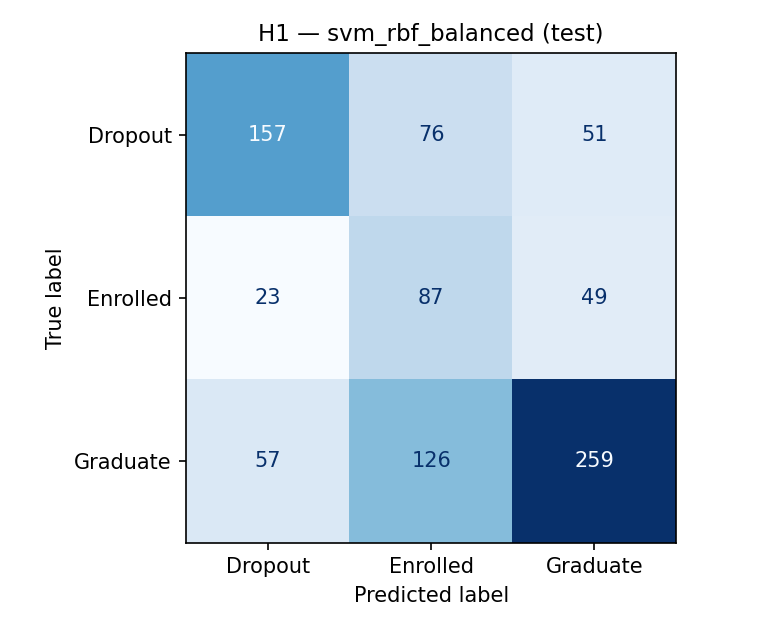
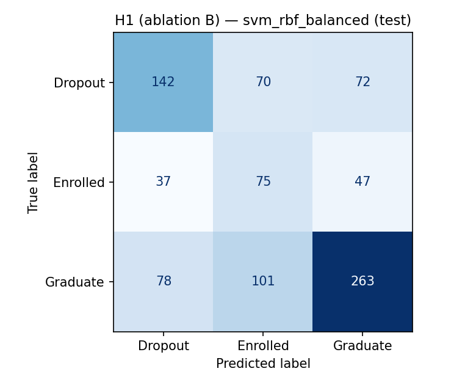
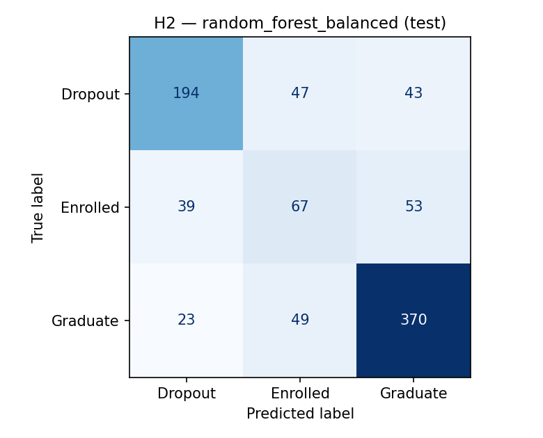
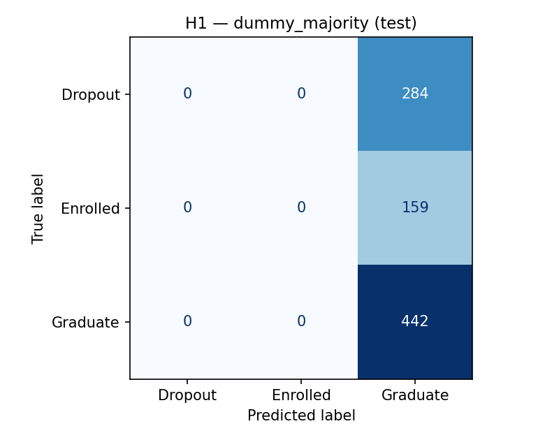

# Model Report — Phase 4

> Generated by `ml/training/train.py`. **Selection used CV only; the test split was evaluated once, in a single terminal pass, after all choices were locked.**

## 1. Protocol (fixed before any result was seen)

- Data: UCI #697, stratified 80/20 split (seed 42) → 3539 train / 885 test rows.
- CV: StratifiedKFold(5, shuffle, seed 42) over the FULL pipeline; metrics from pooled out-of-fold predictions; preprocessing refit per fold.
- Selection: max CV macro-F1 (tie-break: CV balanced accuracy).
- Terminal test: one pass over all pre-declared configs AFTER selection; no re-selection or parameter change followed.
- Candidates: 15 pre-declared configs (`ml/training/models.py`) — defaults + pre-declared depth grid {3,5,10} for DT + `class_weight='balanced'` variants where supported. No other tuning.

## 2. H1 — 5-fold CV on train (24 features)

**CV-selected winner: `svm_rbf_balanced`** (max macro-F1).

| config | CV macro-F1 | ±std | bal-acc | R:Drop | R:Enr | R:Grad | AUC | fit s |
|---|---|---|---|---|---|---|---|---|
| svm_rbf_balanced | 0.580 | 0.015 | 0.592 | 0.57 | 0.54 | 0.66 | 0.816 | 2.2 |
| random_forest_balanced | 0.577 | 0.014 | 0.574 | 0.64 | 0.32 | 0.76 | 0.820 | 1.1 |
| logreg_balanced | 0.566 | 0.019 | 0.575 | 0.58 | 0.49 | 0.65 | 0.811 | 0.6 |
| logreg | 0.553 | 0.013 | 0.550 | 0.61 | 0.20 | 0.84 | 0.818 | 0.5 |
| svm_linear | 0.525 | 0.016 | 0.532 | 0.60 | 0.13 | 0.86 | 0.803 | 2.0 |
| random_forest | 0.514 | 0.019 | 0.526 | 0.61 | 0.10 | 0.87 | 0.817 | 1.0 |
| decision_tree_d10 | 0.501 | 0.016 | 0.503 | 0.55 | 0.17 | 0.79 | 0.718 | 0.1 |
| knn5 | 0.493 | 0.011 | 0.492 | 0.54 | 0.21 | 0.73 | 0.725 | 0.1 |
| svm_rbf | 0.490 | 0.010 | 0.514 | 0.59 | 0.05 | 0.91 | 0.805 | 1.9 |
| decision_tree_balanced | 0.487 | 0.019 | 0.488 | 0.52 | 0.30 | 0.63 | 0.650 | 0.1 |
| decision_tree | 0.483 | 0.019 | 0.483 | 0.54 | 0.26 | 0.65 | 0.652 | 0.1 |
| decision_tree_d5 | 0.461 | 0.013 | 0.488 | 0.56 | 0.04 | 0.87 | 0.770 | 0.1 |
| decision_tree_d3 | 0.449 | 0.005 | 0.485 | 0.61 | 0.01 | 0.83 | 0.760 | 0.1 |
| gauss_nb | 0.228 | 0.010 | 0.390 | 0.25 | 0.91 | 0.01 | 0.671 | 0.1 |
| dummy_majority | 0.222 | 0.000 | 0.333 | 0.00 | 0.00 | 1.00 | 0.500 | 0.0 |

## 3. H1 winner — terminal test results

Configuration: `svm_rbf_balanced` — selected by CV (CV macro-F1 0.580) before the test pass ran.

| metric | value |
|---|---|
| **macro-F1 (primary)** | **0.546** |
| balanced accuracy | 0.562 |
| accuracy (reference only) | 0.568 |
| ROC-AUC (Dropout vs rest) | 0.813 |
| recall Dropout | 0.553 |
| recall Enrolled | 0.547 |
| recall Graduate | 0.586 |
| precision Dropout | 0.662 |

Confusion matrix (rows=true, cols=predicted):

| (true \ predicted) | Dropout | Enrolled | Graduate |
|---|---|---|---|
| Dropout | 157 | 76 | 51 |
| Enrolled | 23 | 87 | 49 |
| Graduate | 57 | 126 | 259 |

## 4. H1 — full terminal test table (transparency; selection already locked)

| config | test macro-F1 | test bal-acc | test acc | test AUC | R:Drop | R:Enr | R:Grad |
|---|---|---|---|---|---|---|---|
| svm_rbf_balanced | 0.546 | 0.562 | 0.568 | 0.813 | 0.55 | 0.55 | 0.59 |
| logreg_balanced | 0.545 | 0.557 | 0.568 | 0.810 | 0.58 | 0.51 | 0.58 |
| random_forest_balanced | 0.539 | 0.538 | 0.608 | 0.805 | 0.62 | 0.28 | 0.72 |
| random_forest | 0.524 | 0.529 | 0.638 | 0.801 | 0.62 | 0.14 | 0.83 |
| logreg | 0.505 | 0.512 | 0.623 | 0.811 | 0.59 | 0.12 | 0.82 |
| svm_rbf | 0.492 | 0.510 | 0.637 | 0.802 | 0.59 | 0.07 | 0.87 |
| svm_linear | 0.489 | 0.506 | 0.629 | 0.815 | 0.60 | 0.07 | 0.85 |
| decision_tree | 0.484 | 0.484 | 0.545 | 0.664 | 0.55 | 0.26 | 0.64 |
| decision_tree_d5 | 0.475 | 0.495 | 0.607 | 0.767 | 0.62 | 0.08 | 0.79 |
| knn5 | 0.470 | 0.469 | 0.551 | 0.716 | 0.49 | 0.20 | 0.72 |
| decision_tree_d10 | 0.468 | 0.471 | 0.568 | 0.730 | 0.52 | 0.14 | 0.75 |
| decision_tree_balanced | 0.464 | 0.465 | 0.515 | 0.643 | 0.51 | 0.28 | 0.60 |
| decision_tree_d3 | 0.441 | 0.479 | 0.597 | 0.769 | 0.64 | 0.02 | 0.78 |
| gauss_nb | 0.231 | 0.401 | 0.254 | 0.697 | 0.24 | 0.95 | 0.01 |
| dummy_majority | 0.222 | 0.333 | 0.499 | 0.500 | 0.00 | 0.00 | 1.00 |

Constant 'Graduate' bar on the same test rows: accuracy 0.499, macro-F1 0.222, AUC 0.500.

Reading the table: `class_weight='balanced'` consistently trades raw accuracy for minority-class recall (e.g. logreg accuracy 0.623 → 0.568 while Enrolled recall rises 0.12 → 0.51 and macro-F1 rises 0.505 → 0.545). Accuracy-optimizing rows look "better" only because they lean on the 49.9% Graduate majority — which is exactly the trap macro-F1 exposes.

## 5. Ablation — four uncertain features (docs/LEAKAGE_AUDIT.md §3)

Same config (`svm_rbf_balanced`), H1 with (A=24 features) vs. without (B=20) `Displaced`, `Debtor`, `Tuition fees up to date`, `Scholarship holder`:

| variant | CV macro-F1 | test macro-F1 |
|---|---|---|
| A (with, 24) | 0.580 | 0.546 |
| B (without, 20) | 0.528 | 0.511 |
| **Δ (B − A)** | **-0.052** | **-0.035** |

Interpretation rule (pre-declared): |Δ| small → the timing ambiguity of those four columns is immaterial for H1; large Δ → their legitimacy must be argued before adoption. Outcome recorded in the Phase-5 model card.

**Measured outcome: ΔCV = -0.052, Δtest = -0.035 — NOT small.** The four features carry real signal, so the ambiguity is NOT immaterial: adopting the 24-feature H1 model requires either confirming their enrollment-time provenance with the data providers, or quoting the 20-feature Experiment B numbers as the conservative H1 result. Both are reported above; no silent choice is made here.

## 6. H2 — 5-fold CV on train (30 features)

**CV-selected winner: `random_forest_balanced`** (max macro-F1).

| config | CV macro-F1 | ±std | bal-acc | R:Drop | R:Enr | R:Grad | AUC | fit s |
|---|---|---|---|---|---|---|---|---|
| random_forest_balanced | 0.682 | 0.025 | 0.677 | 0.73 | 0.45 | 0.86 | 0.895 | 1.1 |
| logreg_balanced | 0.681 | 0.019 | 0.687 | 0.71 | 0.56 | 0.79 | 0.898 | 0.6 |
| svm_rbf_balanced | 0.679 | 0.017 | 0.685 | 0.66 | 0.59 | 0.81 | 0.897 | 1.7 |
| svm_linear | 0.663 | 0.020 | 0.655 | 0.74 | 0.33 | 0.90 | 0.898 | 1.7 |
| logreg | 0.660 | 0.016 | 0.653 | 0.75 | 0.30 | 0.90 | 0.902 | 0.5 |
| svm_rbf | 0.651 | 0.013 | 0.641 | 0.72 | 0.27 | 0.94 | 0.895 | 1.5 |
| random_forest | 0.640 | 0.018 | 0.636 | 0.76 | 0.22 | 0.93 | 0.897 | 1.1 |
| decision_tree_d5 | 0.606 | 0.009 | 0.606 | 0.72 | 0.20 | 0.90 | 0.864 | 0.1 |
| decision_tree_d3 | 0.605 | 0.049 | 0.601 | 0.67 | 0.26 | 0.87 | 0.848 | 0.1 |
| decision_tree_d10 | 0.603 | 0.020 | 0.601 | 0.69 | 0.26 | 0.85 | 0.787 | 0.1 |
| knn5 | 0.578 | 0.021 | 0.573 | 0.63 | 0.26 | 0.84 | 0.819 | 0.1 |
| decision_tree | 0.577 | 0.017 | 0.577 | 0.67 | 0.30 | 0.76 | 0.763 | 0.1 |
| decision_tree_balanced | 0.575 | 0.028 | 0.574 | 0.65 | 0.34 | 0.73 | 0.748 | 0.1 |
| gauss_nb | 0.232 | 0.013 | 0.393 | 0.26 | 0.91 | 0.01 | 0.687 | 0.1 |
| dummy_majority | 0.222 | 0.000 | 0.333 | 0.00 | 0.00 | 1.00 | 0.500 | 0.0 |

## 7. H2 — winner terminal test results

Winner: `random_forest_balanced` (CV macro-F1 0.682).

| metric | value |
|---|---|
| **macro-F1** | **0.650** |
| balanced accuracy | 0.647 |
| ROC-AUC (Dropout) | 0.890 |
| recall Dropout | 0.683 |
| recall Enrolled | 0.421 |
| recall Graduate | 0.837 |

Confusion matrix:

| (true \ predicted) | Dropout | Enrolled | Graduate |
|---|---|---|---|
| Dropout | 194 | 47 | 43 |
| Enrolled | 39 | 67 | 53 |
| Graduate | 23 | 49 | 370 |

H1 winner vs H2 winner test macro-F1: 0.546 → 0.650 (information value of semester-1 data).

Transparency note: on the H2 test pass, `svm_rbf_balanced` scored 0.666 vs the CV-selected `random_forest_balanced` 0.650. CV and test can rank near-ties differently — the protocol keeps the CV choice (0.682 vs 0.679 on CV) because re-selecting on test results would be test-set leakage. A gap this size (within fold noise) means the candidates are best read as statistically indistinguishable at this sample size.

## 8. Limitations & next steps

- Preprocessing is refit per CV fold; test used once — no leakage in the reported protocol.
- Searched space is deliberately tiny (DT depth grid + balanced class weights). A proper hyperparameter search needs nested CV and is deferred.
- Binary at-risk view (Dropout vs rest, ROC-AUC with threshold selection) is a later, isolated experiment (3-class stays the primary target).
- Fairness slices (Gender, Age, Scholarship) are planned for the model card in Phase 5+.

---
*Next: Phase 5 — model registry + inference layer.*
